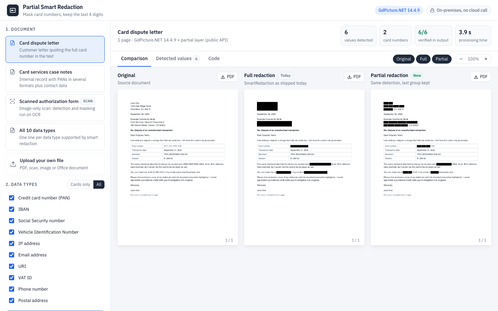
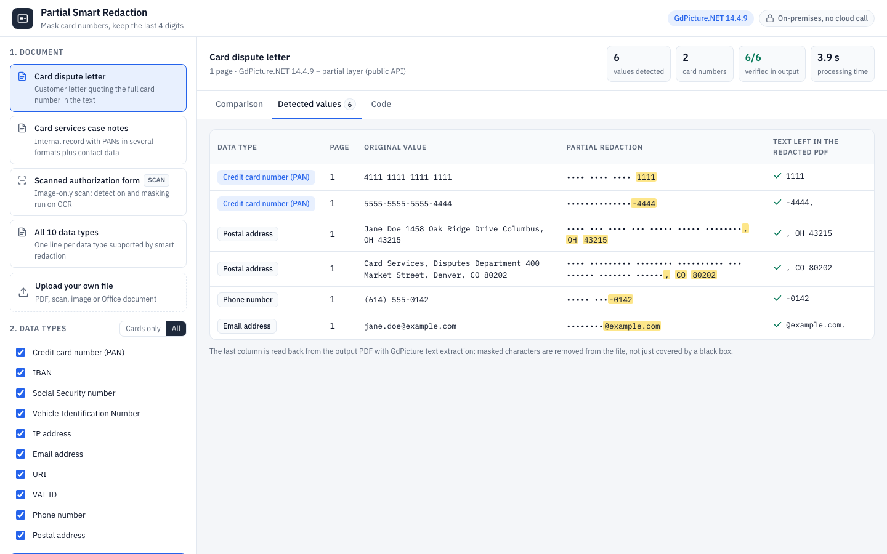
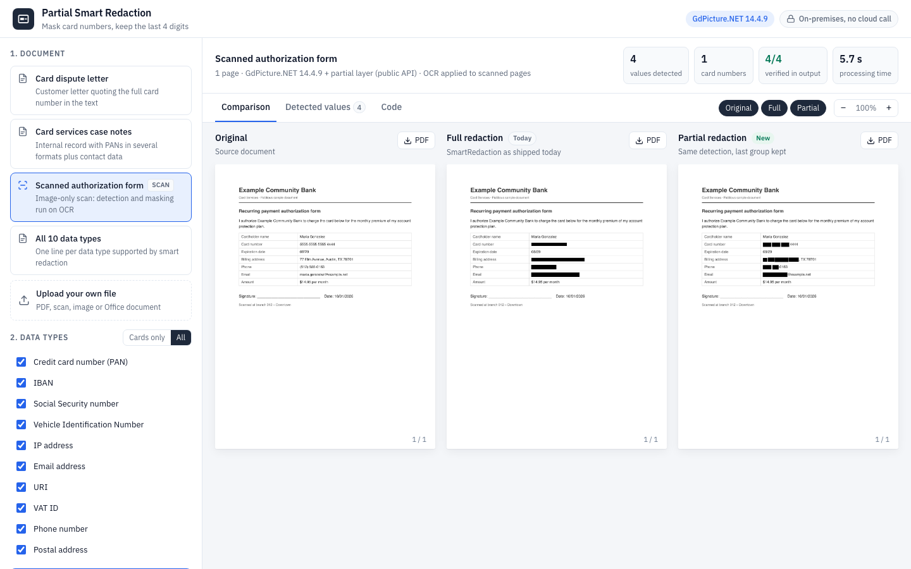

# Nutrient Partial Smart Redaction

A Nutrient.io demo that detects card numbers and other personal data with GdPicture.NET smart redaction, then redacts them in full or partially, keeping only the last logical group, for example `4111 1111 1111 1111` to `•••• •••• •••• 1111`.



1. **Input.** One of the fictitious samples, or your own PDF, scan, image or Office document. Non-PDF files are converted to PDF with GdPicture.
2. **Detection.** GdPicture `SmartRedaction` runs once per selected data type, in parallel, in mark-only mode, so every detected area carries its type. Image-only pages get an OCR text layer first.
3. **Full redaction.** `SmartRedaction` with `Immediate = true`: the whole value is removed, as the SDK does today.
4. **Partial redaction.** Character geometry from GdPicture text extraction shrinks each detected area to the characters to hide, and `ApplyRedaction` burns the result into the PDF. When the installed GdPicture.NET exposes the `SmartRedactionOptions.PartialRedaction` option (next release), the demo uses it instead.
5. **Proof.** The text left in each redacted area is read back from the output PDF. Hidden characters are removed from the file, not just covered.

Everything runs locally. No cloud service is called.

## Rules applied by partial redaction

| Data type | Kept |
|---|---|
| Credit card number (PAN) | Last 4 digits |
| IBAN, VIN | Last 4 characters |
| Social Security number | Last 4 digits |
| Phone number | Last 4 digits |
| IP address | Last group (`.12`) |
| Email address | Domain (`@example.com`) |
| URI | Last path segment |
| VAT ID | Last group |
| Postal address | State and ZIP code |

## Prerequisites

- .NET SDK 10
- Windows, macOS or Linux
- For scanned documents: the English OCR dictionary `eng.traineddata`. It is not stored in this repository. Get it from one of these sources:
  - the [GdPicture.Resources](https://www.nuget.org/packages/GdPicture.Resources) NuGet package (`runtimes/any/native/eng.traineddata`); the app finds it in the local NuGet cache (`~/.nuget/packages/gdpicture.resources`) if it is there;
  - <https://github.com/tesseract-ocr/tessdata_fast/raw/main/eng.traineddata>.

  Put the file in `PartialRedactionDemo/ocr/`, or set `OCR_RESOURCES_PATH` to the folder that contains it.

## Environment variables

Keys are only read from environment variables, never from code. Start from `.env.example`.

| Variable | Purpose | Default |
|---|---|---|
| `GDPICTURE_LICENSE_KEY` | GdPicture.NET license key | empty = evaluation mode |
| `OCR_RESOURCES_PATH` | Folder that contains `eng.traineddata` | `ocr` next to the app, then the GdPicture.Resources package in the NuGet cache |
| `ASPNETCORE_URLS` | Address the server listens on | `http://localhost:5320` (from `appsettings.json`) |

In evaluation mode GdPicture stamps a watermark on every document it writes, including the samples it generates. The watermark adds text to the scanned sample, so OCR is skipped and nothing is detected on it. Use a license key (for example a trial key from nutrient.io) to see the full behaviour. Samples generated in evaluation mode and with a key are kept in separate folders, so they are regenerated after you set a key. A rejected key is logged and the app falls back to evaluation mode.

## Build and run

```bash
dotnet build PartialRedactionDemo
```

```bash
set -a && source .env && set +a && dotnet run --project PartialRedactionDemo
```

Open <http://localhost:5320>.

On first start the app generates the four fictitious samples with GdPicture (HTML to PDF, plus a rasterised copy for the scanned case) in `bin/.../Samples`. They use test card numbers, `example.com` addresses, documentation IP ranges and invented names. The generator is `PartialRedactionDemo/SampleFactory.cs`.

## Using the app

1. Pick a sample, or upload your own file.
2. Choose the data types: **Cards only**, **All**, or any combination.
3. Click **Redact document**. Picking a sample runs it straight away.
4. **Comparison** shows the original, the full redaction and the partial redaction side by side. Toggle the columns, zoom, or download each PDF.
5. **Detected values** lists each value with its type, page, original text, partial display and the text read back from the redacted PDF. A check mark means only the kept characters are left in the file.

   

6. **Code** shows the one-line `PartialRedaction` option and the rule per data type.

The scanned sample is an image-only page: detection and masking run on the OCR text layer.



## API

| Method and path | Description |
|---|---|
| `GET /api/info` | `{ engine, gdPictureVersion, nativePartialRedaction, types, samples }` |
| `GET /api/samples/{id}.pdf` | A generated sample |
| `POST /api/redact` | multipart: `types` (comma-separated ids, for example `creditCard,ssn`) and either `sample` (sample id) or `file`. Returns `{ jobId, name, engine, timings, ocrUsed, pages, findings }` |
| `GET /api/jobs/{id}/{variant}.pdf` | `original`, `full` or `partial` PDF |
| `GET /api/jobs/{id}/{variant}/{page}.png` | Page image at 144 DPI |

Jobs are kept for three hours in a temporary folder.

## Project layout

| Path | Content |
|---|---|
| `PartialRedactionDemo/Program.cs` | Web API (ASP.NET Core minimal API) |
| `PartialRedactionDemo/RedactionEngine.cs` | Full and partial redaction with GdPicture |
| `PartialRedactionDemo/PartialRules.cs` | Which characters stay visible per data type |
| `PartialRedactionDemo/PiiTypes.cs` | Supported data types |
| `PartialRedactionDemo/SampleFactory.cs` | Fictitious sample documents |
| `PartialRedactionDemo/OcrResources.cs` | Finds the OCR dictionary |
| `PartialRedactionDemo/wwwroot` | Web user interface |
